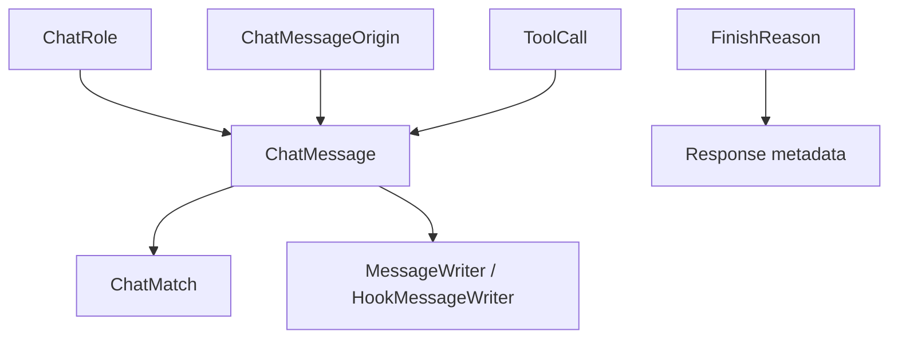

<a id="readme-top"></a>

<h1 align="center">@johannes.latzel/llm-chat-message</h1>

[](https://opensource.org/licenses/MIT)
[](https://www.npmjs.com/package/@johannes.latzel/llm-chat-message)
[](https://github.com/johanneslatzel/llm-chat-message/releases)
[](https://www.typescriptlang.org/)
[](https://github.com/johanneslatzel/llm-chat-message/pulls)
[](https://github.com/johanneslatzel/llm-chat-message/discussions)
[](https://codecov.io/gh/johanneslatzel/llm-chat-message)
[](https://github.com/johanneslatzel/llm-chat-message/actions/workflows/ci.yml)
[](https://socket.dev/npm/package/@johannes.latzel/llm-chat-message)
[](https://github.com/mefengl/made-by-ai)

<p align="center">
Provider-neutral chat message, role, finish-reason and writer primitives for TypeScript
</p>

<p align="center">
<a href="https://www.npmjs.com/package/@johannes.latzel/llm-chat-message">npm</a>
&middot;
<a href="https://github.com/johanneslatzel/llm-chat-message">GitHub</a>
&middot;
<a href="https://johanneslatzel.github.io/llm-chat-message/">Docs</a>
&middot;
<a href="#quick-start">Quick start</a>
&middot;
<a href="https://github.com/johanneslatzel/llm-chat-message/issues">Issues</a>
&middot;
<a href="https://github.com/johanneslatzel/llm-chat-message/releases">Releases</a>
</p>



<details>
<summary>Table of Contents</summary>

- [Why This Package](#why-this-package)
- [Features](#features)
- [Prerequisites](#prerequisites)
- [Installation](#installation)
- [Quick Start](#quick-start)
    - [Create a message](#create-a-message)
    - [Implement a writer](#implement-a-writer)
- [Message Model](#message-model)
    - [Roles](#roles)
    - [Origins](#origins)
    - [Tool calls](#tool-calls)
- [Finish Reasons](#finish-reasons)
- [Writers](#writers)
- [Documentation](#documentation)
- [Development](#development)
- [Scope](#scope)
- [Contributing](#contributing)
- [License](#license)

</details>

## Why This Package

`@johannes.latzel/llm-chat-message` is a base package. It owns the vocabulary
that describes a chat message independently of any engine, transport or
provider.

It defines values and shapes only; it
does not send messages, call a model or manage a conversation.

Keeping the message model in its own package lets an engine, a tool package and
an adapter agree on the same message shapes without depending on each other.

## Features

- `ChatRole` and `ChatMessageOrigin` enums
- `ChatMessage` and `ToolCall` types
- `ChatMatch` for regex-matched message callbacks
- `MessageWriter` and `HookMessageWriter` interfaces
- `FinishReason` enum
- zero runtime dependencies

## Prerequisites

| Requirement | Value |
|---|---|
| Node.js | >= 18 |
| Module format | ESM-only (no CommonJS build) |
| TypeScript | Optional; `.d.ts` files included |

## Installation

```bash
npm install @johannes.latzel/llm-chat-message
```

## Quick Start

### Create a message

```typescript
import {
    ChatMessageOrigin,
    ChatRole,
    type ChatMessage,
    type ToolCall,
} from '@johannes.latzel/llm-chat-message';

const call: ToolCall = {
    id: 'call_1',
    type: 'function',
    function: { name: 'greet', arguments: '{"name":"Ada"}' },
};

const message: ChatMessage = {
    role: ChatRole.Assistant,
    content: 'Hello, Ada!',
    createdAt: new Date(),
    origin: ChatMessageOrigin.Model,
    tool_calls: [call],
};
```

### Implement a writer

`MessageWriter` is a structural interface. A host can implement it without
depending on a concrete chat implementation:

```typescript
import {
    ChatMessageOrigin,
    ChatRole,
    type ChatMessage,
    type MessageWriter,
} from '@johannes.latzel/llm-chat-message';

class InMemoryWriter implements MessageWriter {
    readonly messages: ChatMessage[] = [];

    async user(content: string): Promise<void> {
        this.add(ChatRole.User, content);
    }

    async assistant(content: string): Promise<void> {
        this.add(ChatRole.Assistant, content);
    }

    async tool(content: string): Promise<void> {
        this.add(ChatRole.Tool, content);
    }

    async reasoning(content: string): Promise<void> {
        this.add(ChatRole.Reasoning, content);
    }

    private add(role: ChatRole, content: string): void {
        this.messages.push({
            role,
            content,
            createdAt: new Date(),
            origin: role === ChatRole.User ? ChatMessageOrigin.User : ChatMessageOrigin.Model,
        });
    }
}
```

[Back to top](#readme-top)

## Message Model

`ChatMessage` is the complete message shape:

```typescript
type ChatMessage = {
    role: ChatRole;
    content: string;
    createdAt: Date;
    tool_call_id?: string;
    tool_calls?: ToolCall[];
    origin: ChatMessageOrigin;
};
```

### Roles

| Role | Value | Meaning |
|---|---|---|
| `System` | `system` | System instructions |
| `Developer` | `developer` | Developer instructions |
| `User` | `user` | User input |
| `Assistant` | `assistant` | Model output |
| `Tool` | `tool` | Tool result |
| `Reasoning` | `reasoning` | Model reasoning |

### Origins

| Origin | Value | Meaning |
|---|---|---|
| `User` | `user` | Added by a user |
| `Model` | `model` | Produced by a model |
| `Hook` | `hook` | Inserted by a hook |
| `Tool` | `tool` | Produced by a tool |
| `System` | `system` | Added by system prompt handling |

### Tool calls

`ToolCall` records a function call requested by a model:

```typescript
type ToolCall = {
    id: string;
    type: 'function';
    function: {
        name: string;
        arguments: string;
    };
};
```

`ChatMatch` pairs a message with a successful regular-expression match. It is
used by message-filtering callbacks.

[Back to top](#readme-top)

## Finish Reasons

`FinishReason` describes why a stream or response ended:

| Value | Meaning |
|---|---|
| `Stop` | Natural completion |
| `ToolCalls` | The model requested tools |
| `Length` | A token limit was reached |
| `ContentFilter` | Content was filtered |
| `Aborted` | The caller aborted the request |

[Back to top](#readme-top)

## Writers

`MessageWriter` appends messages without exposing message origin:

```typescript
interface MessageWriter {
    user(content: string): Promise<void>;
    assistant(content: string, tool_calls?: ToolCall[]): Promise<void>;
    tool(content: string, tool_call_id: string): Promise<void>;
    reasoning(content: string): Promise<void>;
}
```

`HookMessageWriter` adds an explicit `ChatMessageOrigin` to every method, so
hooks can tag messages they insert:

```typescript
interface HookMessageWriter {
    user(content: string, origin: ChatMessageOrigin): Promise<void>;
    assistant(
        content: string,
        tool_calls: ToolCall[] | undefined,
        origin: ChatMessageOrigin,
    ): Promise<void>;
    tool(content: string, tool_call_id: string, origin: ChatMessageOrigin): Promise<void>;
    reasoning(content: string, origin: ChatMessageOrigin): Promise<void>;
}
```

[Back to top](#readme-top)

## Documentation

Full documentation at **[johanneslatzel.github.io/llm-chat-message/](https://johanneslatzel.github.io/llm-chat-message/)**.

- [Overview](https://johanneslatzel.github.io/llm-chat-message/)
- [Quick start](https://johanneslatzel.github.io/llm-chat-message/quickstart/)
- [Messages and roles](https://johanneslatzel.github.io/llm-chat-message/messages/)
- [Writers](https://johanneslatzel.github.io/llm-chat-message/writers/)
- [Architecture](https://johanneslatzel.github.io/llm-chat-message/architecture/)
- [API reference](https://johanneslatzel.github.io/llm-chat-message/api-reference/)

[Back to top](#readme-top)

## Development

```bash
git clone https://github.com/johanneslatzel/llm-chat-message.git
cd llm-chat-message
npm install
npm run verify
```

`npm run verify` runs the type check, lint, file-size checks, documentation
checks, and the test suite with coverage.

[Back to top](#readme-top)

## Scope

This package is deliberately self-contained:

- message vocabulary only
- no chat loop, model client, HTTP layer or configuration loader
- no coupling to a specific transport, engine or provider

[Back to top](#readme-top)

## Contributing

Issues and PRs are welcome at [github.com/johanneslatzel/llm-chat-message](https://github.com/johanneslatzel/llm-chat-message).

## License

MIT. See [`LICENSE`](LICENSE).
