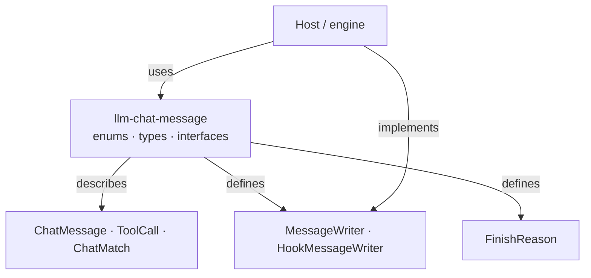

# Architecture

## Scope

`llm-chat-message` is a leaf package. It depends on nothing and is depended on
by the layers that need a shared message vocabulary.

## Type relationships

- `ChatMessage` combines a `ChatRole`, content, timestamp, optional tool-call
  data and a `ChatMessageOrigin`.
- `ToolCall` is the function-call payload carried by an assistant message and
  referenced by a tool result.
- `ChatMatch` pairs a `ChatMessage` with a successful regular-expression match.
- `MessageWriter` and `HookMessageWriter` describe how consumers append
  messages.
- `FinishReason` describes why a stream or response ended.

## No runtime behavior

The only runtime values are the three enums. Storage, validation, transport and
conversation management belong to the consumer. This keeps the package usable
from an engine, a tool adapter or a test double without pulling in any of them.

## Dependencies

None at runtime.
