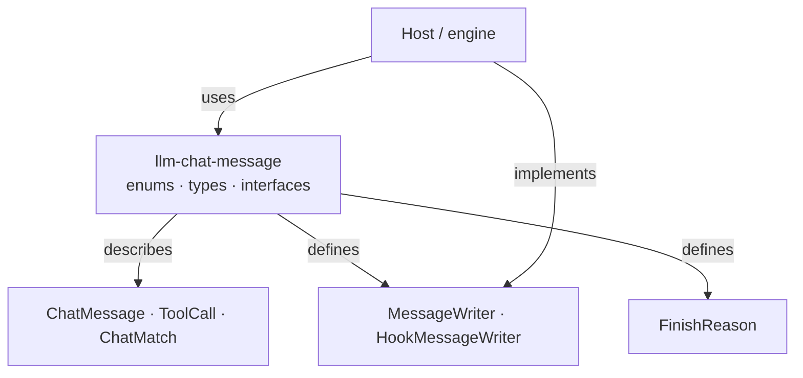

# Architecture

## Overview

`llm-chat-message` is a leaf package. It defines the message vocabulary used by chat engines, tool packages and adapters.

## Type Relationships

- `ChatMessage` combines a `ChatRole`, content, timestamp, optional tool-call data and a `ChatMessageOrigin`.
- `ToolCall` is the function-call payload carried by an assistant message and referenced by a tool result.
- `ChatMatch` pairs a `ChatMessage` with a successful regular-expression match.
- `MessageWriter` and `HookMessageWriter` describe how consumers append messages.
- `FinishReason` describes why a stream or response ended.

## No Runtime Behavior

The only runtime values are the three enums. Storage, validation, transport and conversation management belong to the consumer.
