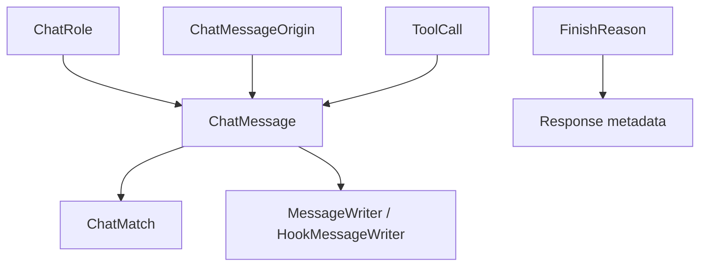

# Overview

`@johannes.latzel/llm-chat-message` owns the message vocabulary shared by chat
engines, tool packages and adapters. It has no runtime dependencies and does
not execute a conversation.

## What is included

- `ChatRole` and `ChatMessageOrigin`
- `ChatMessage` and `ToolCall`
- `ChatMatch`
- `MessageWriter` and `HookMessageWriter`
- `FinishReason`

## Navigation

- [Quick start](quickstart.md) - create a message and implement a writer
- [Messages and roles](messages.md) - roles, origins, tool calls and matches
- [Writers](writers.md) - the two writer interfaces
- [Architecture](architecture.md) - package boundaries and type relationships
- [API reference](api-reference.md) - every exported symbol

## Scope

This package defines message shapes and values. A host owns storage, transport
and conversation behavior.

## License

MIT. See [`LICENSE`](https://github.com/johanneslatzel/llm-chat-message/blob/main/LICENSE).
